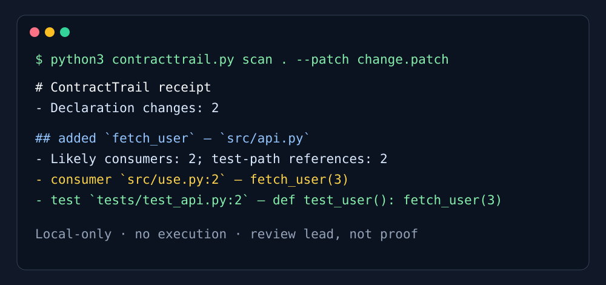

# ContractTrail

**A local review receipt for API declarations changed by a refactor.**

ContractTrail reads a Git patch, finds conservative Python and TypeScript
declaration changes, then lists likely local consumers and test-path
references. It never imports, executes, edits, uploads, or sends repository
content anywhere.


*Conceptual AI-generated workflow illustration: a changed declaration is traced
to likely callers and tests so a developer can focus review effort. The
reproducible terminal demonstration below is the actual CLI output.*



## Why

AI-assisted refactors can change a function or class declaration faster than a
reviewer can trace its call sites. ContractTrail makes that first review pass
explicit and local. It is a lead generator, not a type checker or proof of
correctness.

## Quick start

Python 3 and Git are the only requirements.

```sh
python3 contracttrail.py scan /path/to/repository
python3 contracttrail.py scan . --patch change.patch --json receipt.json
python3 contracttrail.py scan . --strict
python3 -m unittest discover -s tests -v
```

`--strict` exits with code 2 when any changed declaration has no reference in a
test-like path. That is a review prompt, not a claim that coverage is absent.

## What it recognizes

- Python `def` and `class` declarations
- JavaScript/TypeScript `function`, `class`, and `const` declarations
- Added and removed declaration lines in a unified Git patch
- Word-boundary references in local `.py`, `.js`, `.jsx`, `.ts`, `.tsx`, and
  `.md` files
- Test-like paths such as `tests/`, `test_*.py`, `*.test.ts`, and `*.spec.ts`

## Limits

- It does not parse language syntax or resolve imports.
- A textual hit may not be a real call site.
- No test-path hit does not prove no test covers the change.
- It intentionally supports only conservative declaration patterns.

## Project layout

```text
contracttrail.py  standard-library CLI
tests/            fixture-based verification
assets/           reproducible terminal demo
reports/          research, plan, QA, and release receipts
```

## License

[MIT](LICENSE)
